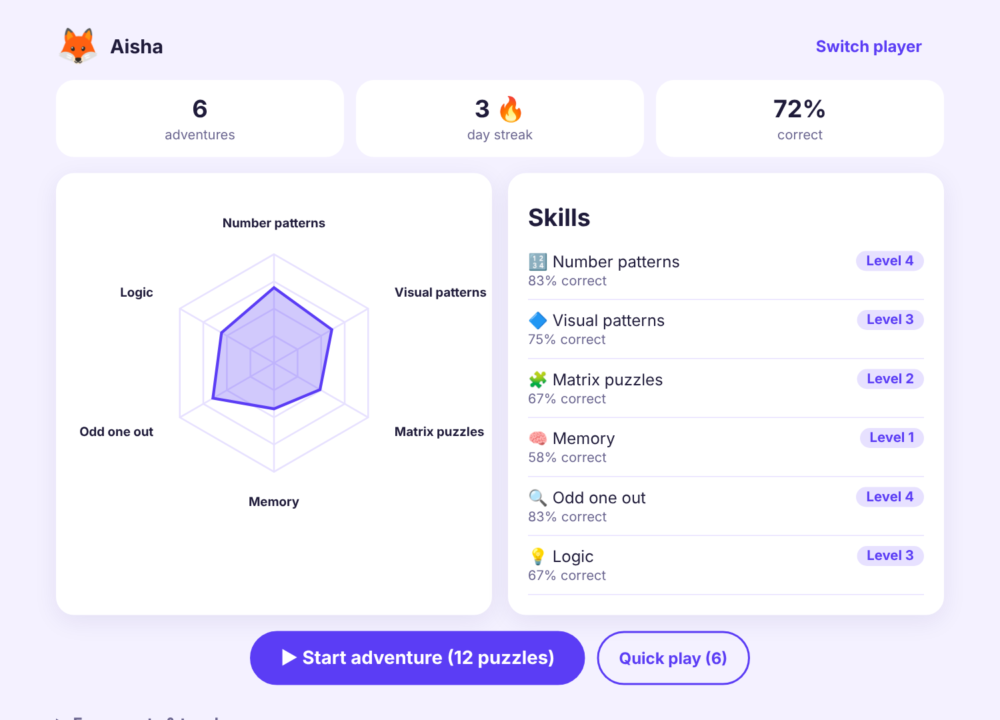
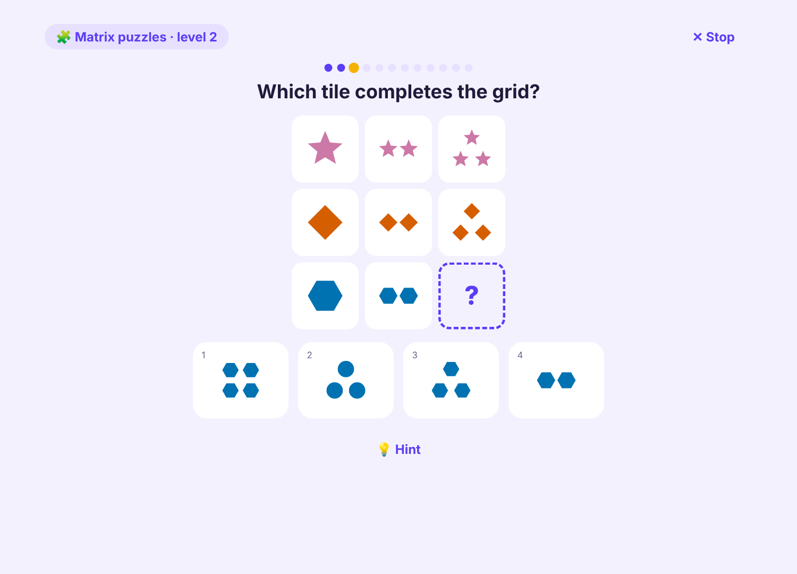

# ✦ Polaris: Adaptive Puzzle Learning for Kids

Polaris teaches children aged 6–12 to reason through short puzzle adventures. Every puzzle adapts to the child's level, every answer comes with an explanation of *why*, and parents can see progress across six thinking skills.

**▶ Live demo:** https://hasnaabdulazeez.github.io/polaris-puzzle-learning/

<p align="center">
  
  
</p>

## What children practise

| Skill | Puzzle | How it gets harder |
|---|---|---|
| 🔢 Number patterns | What comes next in 3, 7, 11, 15, 19? | +n → ×n → growing gaps → alternating rules → Fibonacci-style, squares |
| 🔷 Visual patterns | Continue a repeating row of shapes | Longer repeating units; shape **and** colour change together |
| 🧩 Matrix puzzles | Complete a 3×3 grid (Raven-style) | Row rules → row + column rules → Latin squares with counts |
| 🧠 Memory | A row flashes up, then hides: which shape was third? | Longer rows, less viewing time, look-alike options |
| 🔍 Odd one out | Which one does not belong? | More items, more properties, distracting variation |
| 💡 Logic | "Anu is taller than Ben…" Who is the shortest? | More people, mixed phrasing, "who is in the middle?" |

All puzzles are **generated procedurally**, so children never run out or memorise answers. A wrong answer always shows a worked explanation, which turns mistakes into the main teaching moment.

## Adaptive engine

Each skill has an **Elo-style rating**. Each level 1–10 has a fixed difficulty, and after every answer the rating moves according to how surprising the result was:

```
expected = 1 / (1 + 10^((difficulty(level) − rating) / 400))
rating  += K · (score − expected)        score: 1 correct · 0.5 with hint · 0 wrong
```

- The next puzzle is set at the level the child is expected to solve **about 75% of the time**: challenging, but not discouraging.
- **K** starts high and shrinks with experience, so new players find their level within a few puzzles and then ratings stay stable.
- A **session planner** includes every skill, gives extra practice to the weakest ones, and avoids the same skill twice in a row.

## Engineering notes

- **Zero dependencies and no build step.** Plain ES modules, hand-written SVG shapes and a hand-rolled radar chart. Deployed to **GitHub Pages** by GitHub Actions after tests pass.
- **Seeded RNG** (mulberry32) makes every generator reproducible, which is what makes them testable.
- **27 property-style tests** (Node's built-in test runner) generate 400 puzzles per skill. They check that the answer is correct, options are distinct, every odd-one-out has exactly one defensible answer, and every logic puzzle's clues admit exactly one ordering (brute-forced over all permutations).
- **Accessibility**: Okabe-Ito colour-blind-safe palette, every shape has a spoken label, keyboard play (1–4, Enter), `prefers-reduced-motion` and dark mode.
- **Privacy by design**: no accounts, no tracking, no network calls. Progress stays in the browser's local storage, with a fallback to memory when storage is blocked. Parents can export it as JSON or print a report.

## Run locally

```bash
npm start          # serves the folder at http://localhost:5500
npm test           # node --test
```

Any static file server works (`python -m http.server`). ES modules don't load from `file://`, so open it through a server.

## Project structure

```
index.html, css/styles.css
js/
  app.js               # screens: players → dashboard → puzzle session → summary
  rng.js               # seeded PRNG
  puzzles/             # one generator per skill + shared shapes/options helpers
  engine/adaptive.js   # ratings, level selection, session planning
  engine/progress.js   # profiles, streaks, persistence, export
  ui/render.js         # SVG shapes, stimuli and options
  ui/radar.js          # skills radar chart
tests/                 # generator and engine tests
```

## License

MIT
